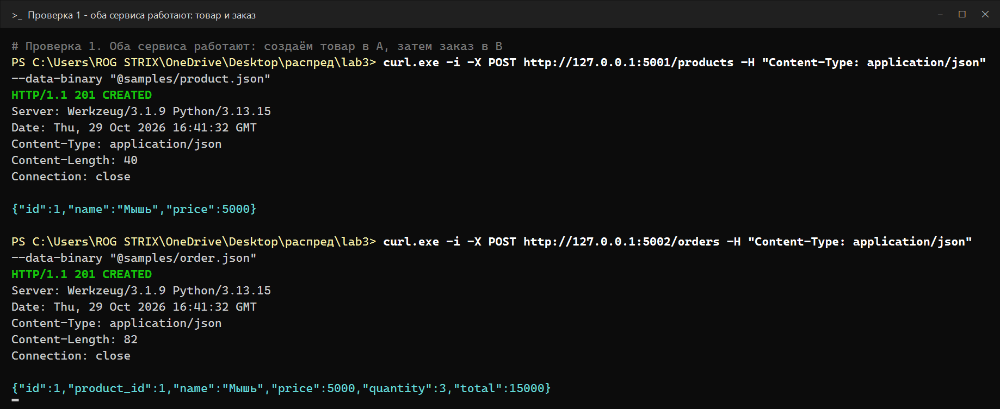
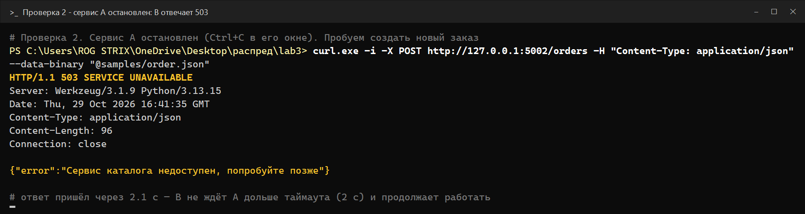
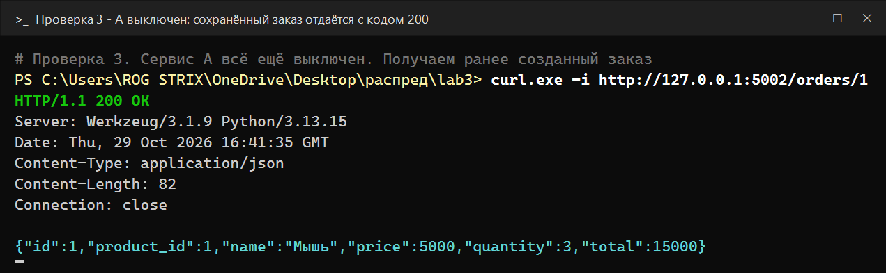
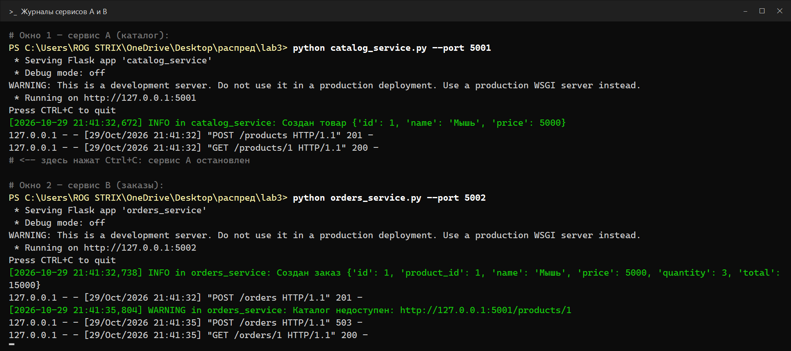

# ЛР3 — REST API и два сервиса: каталог и заказы

Два сервиса на Flask, каждый — отдельный процесс на своём порту. Данные хранятся в памяти.

```
                 POST /orders                    GET /products/{id}
  клиент  ───────────────────►  Сервис B  ───────────────────────►  Сервис A
  (curl)  ◄───────────────────  заказы     ◄─────────────────────── каталог
                 заказ          :5002          товар (таймаут 2 с)   :5001
```

* **Сервис A — каталог** (`catalog_service.py`, порт 5001): товары с `id`, `name`, `price`.
* **Сервис B — заказы** (`orders_service.py`, порт 5002): при создании заказа запрашивает товар у A
  по HTTP с **таймаутом 2 с**, считает сумму и **сохраняет в заказе название и цену**. Поэтому
  сохранённый заказ можно получить, даже когда A выключен.

## Файлы

| Файл | Что это |
|---|---|
| `catalog_service.py` | Сервис A — каталог |
| `orders_service.py` | Сервис B — заказы |
| `requirements.txt` | Зависимости: Flask, requests |
| `samples/*.json` | Тела запросов для curl |
| `test_services.py` | Автотесты: три проверки и обработка ошибок |
| `screenshots/` | Результаты трёх проверок: картинки и текстовые логи в `screenshots/logs/` |

## Запуск

```bash
python -m pip install -r requirements.txt
```

Два отдельных терминала в папке проекта:

```bash
python catalog_service.py --port 5001
```

```bash
python orders_service.py --port 5002 --catalog-url http://127.0.0.1:5001
```

Ключ `--timeout SEC` у сервиса B меняет таймаут запроса к A (по умолчанию 2 с).

## Эндпоинты

| Сервис | Метод и путь | Тело | Ответ |
|---|---|---|---|
| A | `POST /products` | `{"name": "Мышь", "price": 5000}` | `201` товар · `400` неверные данные |
| A | `GET /products/{id}` | — | `200` товар · `404` нет товара |
| B | `POST /orders` | `{"product_id": 1, "quantity": 3}` | `201` заказ · `400` неверные данные · `404` нет товара в каталоге · `503` каталог недоступен |
| B | `GET /orders/{id}` | — | `200` заказ · `404` нет заказа |

Все ответы, включая ошибки, — JSON. Ошибка выглядит так: `{"error": "текст"}`.

## Примеры запросов

В Windows PowerShell пишите `curl.exe` (слово `curl` там занято другой командой). Тело удобнее
передавать из файла: PowerShell 5.1 портит кавычки в JSON, написанном прямо в команде.

```bash
curl.exe -i -X POST http://127.0.0.1:5001/products -H "Content-Type: application/json" --data-binary "@samples/product.json"
```

```bash
curl.exe -i -X POST http://127.0.0.1:5002/orders -H "Content-Type: application/json" --data-binary "@samples/order.json"
```

```bash
curl.exe -i http://127.0.0.1:5002/orders/1
```

В Linux/macOS можно передать JSON прямо: `curl -X POST ... -d '{"product_id": 1, "quantity": 3}'`.

## Результаты трёх проверок

### 1. Оба сервиса работают

Создаём товар в A, затем заказ в B.



```json
{"id": 1, "product_id": 1, "name": "Мышь", "price": 5000, "quantity": 3, "total": 15000}
```

В ответе есть название, цена, количество и итоговая сумма: 5000 × 3 = 15000.

### 2. Сервис A остановлен — B возвращает 503



```
HTTP/1.1 503 SERVICE UNAVAILABLE
{"error": "Сервис каталога недоступен, попробуйте позже"}
```

B не может достучаться до A и через 2 секунды (таймаут) отвечает кодом 503 с понятной ошибкой в JSON.
Сам B при этом не падает и продолжает принимать запросы — см. проверку 3.

### 3. A выключен — сохранённый заказ отдаётся с кодом 200



```
HTTP/1.1 200 OK
{"id": 1, "product_id": 1, "name": "Мышь", "price": 5000, "quantity": 3, "total": 15000}
```

Название и цена были сохранены в заказе при создании, поэтому для `GET /orders/1` сервис A не нужен.

### Журналы обоих сервисов



В журнале B видно все три шага: `POST /orders 201`, затем `WARNING Каталог недоступен` и
`POST /orders 503`, затем `GET /orders/1 200`. В журнале A видно, как B запросил у него товар:
`GET /products/1 200`.

## Как B обрабатывает отказ сервиса A

| Ситуация | Что ловится в коде | Ответ B |
|---|---|---|
| A выключен — подключиться нельзя | `requests.exceptions.ConnectionError` | `503` «Сервис каталога недоступен» |
| A завис — подключились, но ответа нет дольше таймаута | `requests.exceptions.Timeout` | `503` «Сервис каталога не ответил за 2 с» |
| Товара нет в каталоге (A ответил 404) | `response.status_code == 404` | `404` «Товар не найден в каталоге» |
| A ответил другой ошибкой (например 500) | `status_code != 200` | `502` «Сервис каталога вернул ошибку» |

Без таймаута B мог бы ждать зависший A бесконечно, и запрос клиента повис бы вместе с ним.

> На Windows подключение к закрытому порту не отклоняется мгновенно: система ещё около 2 секунд
> повторяет попытку. Поэтому при выключенном A ответ 503 приходит примерно через 2 с. По той же
> причине в адресе стоит `127.0.0.1`, а не `localhost`: с `localhost` Windows сначала пробует IPv6,
> и ожидание удваивается до 4 с.

## Автотесты

```bash
python -m unittest -v test_services
```

7 тестов, около 10 секунд. Сервисы запускаются настоящими отдельными процессами. Проверяются: три
проверки из задания, ошибки 400 и 404, а также случай «A завис» — он подменён сервером, который
принимает подключение и молчит; B должен вернуть 503 не позже чем через таймаут.
